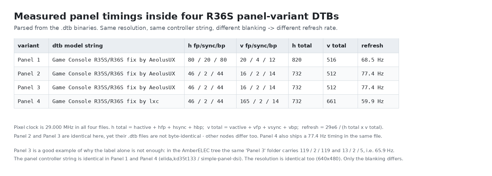
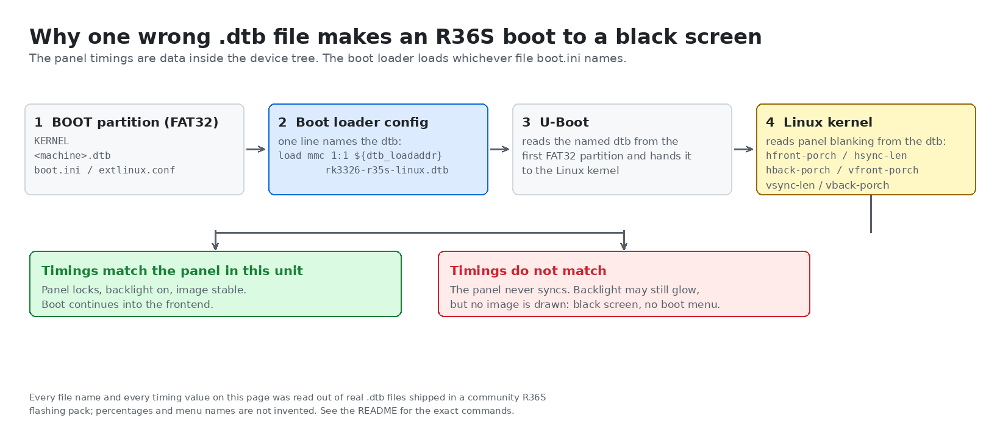
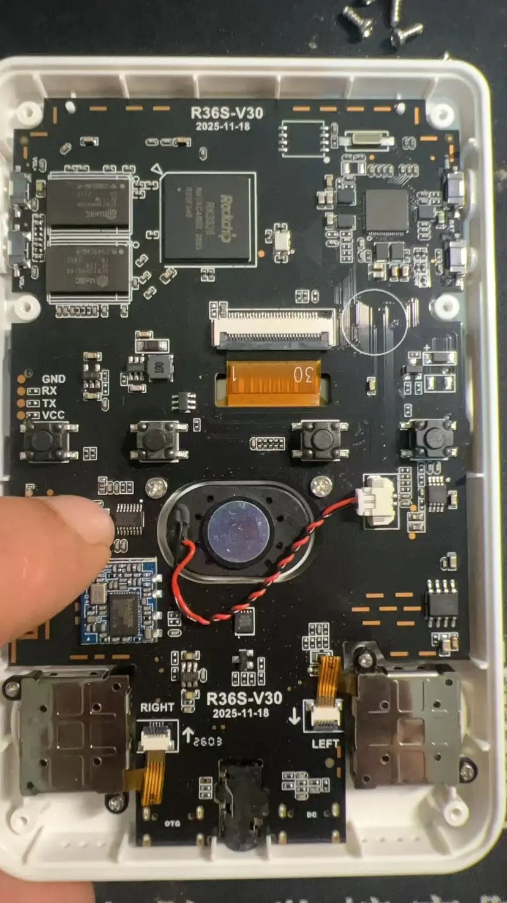
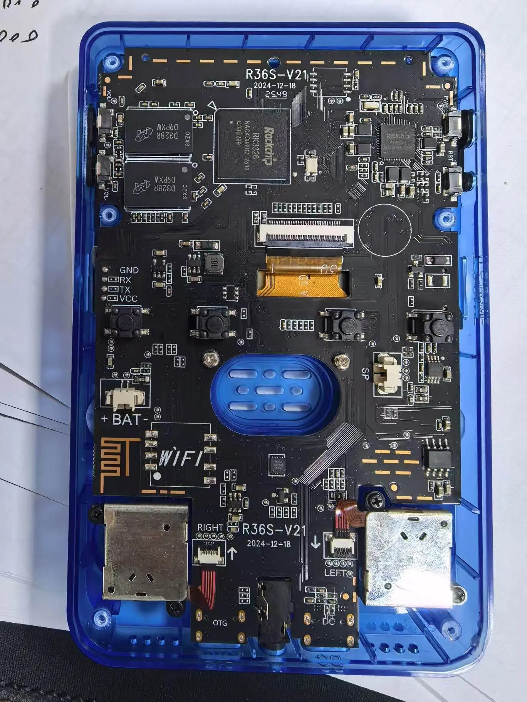
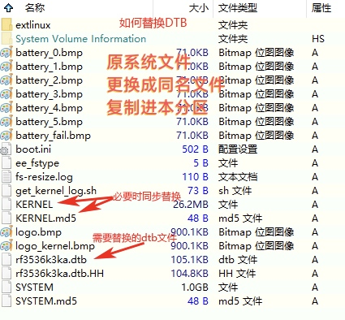
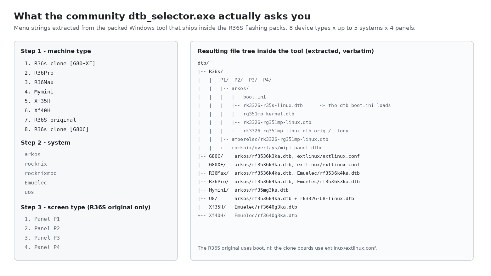
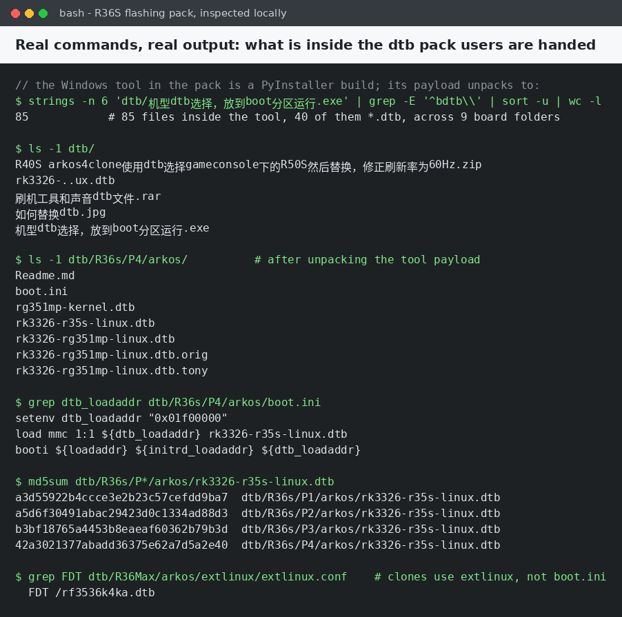

# R36S black screen after flashing: how to find the right DTB for your board

> **Short answer:** On an R36S the screen is described by a *device tree blob* (`.dtb`) file sitting on the FAT32 `BOOT` partition. The boot loader loads exactly one file, named in `boot.ini` (or `extlinux/extlinux.conf`). If that file describes a different panel variant than the one physically fitted to your unit, the panel never syncs and you get a black screen with no error message. Fix it by putting the correct `.dtb` on the `BOOT` partition from a PC — this usually does **not** require re-flashing the whole image.

This page is written from artifacts, not from memory. Every filename, every timing number and every menu string below was read out of real files: a community R36S flashing pack, the `.dtb` binaries inside its Windows `dtb_selector` tool, and the public source of the community firmware projects. Commands you can re-run are shown with their real output. Anything we could not verify is labelled **⚠️ not verified**.

---

## 1. The symptom, in the words people actually use

Quotes from Chinese-language handheld Q&A groups (group name only — the source dataset does not carry reliable per-message attribution, so no usernames are given).

> `[r36s（开源掌机）交流1群]` 大佬们 刚买的新机，要自己刷机dtb试了很多次都黑屏。看群文件也没找到v30的相关信息。
> *"Bought a new unit, tried flashing several times, tried many dtbs, all black screen. Looked in the group files and found nothing about the V30."*

> `[r36s（开源掌机）交流1群]` 现在进来就是想找v30 dtb 试过几个固件都没专用的就来这里找找看了
> *"I'm here to find a V30 dtb. I tried several firmware images, none had one specifically for it."*

> `[开源掌机中文社区⑤群]` 主要是我找不到能用的镜像文件 ／ 没有对应的dtb ／ 找不到dtb ／ dtb没选对吧 ／ 有没有这个板子能用的镜像
> *"I can't find a usable image file / there's no matching dtb / can't find a dtb / the dtb is probably the wrong pick / is there an image that works on this board?"*

> `[开源掌机中文社区⑤群]` 你这个没有带 dtb ？ ／ `rk3326-r36s-sauce04-linux.dtb` ／ 如何替换dtb.jpg
> *"Does yours not come with a dtb? / `rk3326-r36s-sauce04-linux.dtb` / [attached a picture titled] how-to-replace-the-dtb.jpg"*

> `[r36s（开源掌机）交流1群]` v30要刷最新的arkos4clone，已经解决wifi问题了
> *"For V30 you flash the latest arkos4clone; that fixed the WiFi."*

> `[r36s（开源掌机）交流1群]` 这个ARKOS刷机文件3.6G的里面带游戏吗
> *"Does the 3.6 GB ArkOS flashing file come with games?"* (It does not — see §7.)

> `[R36S掌机爱好者]` — a group member pasted the output of a dtb analysis tool, verbatim:
> ```
> ⚠️ ⚠️ 部分匹配（屏幕参数一致，MD5不同）
> 🔋 你的dtb中电池设计容量为: 3380
> 🔋 你的dtb中电池最大容量为: 3718
>
> 检测到屏幕参数一致但MD5不同，可以尝试以下设备选项：
> 运行 dtb_selector 后依次尝试以下选项，选择兼容性最好的：
> • Game Console → Game Console R36s Panel 4
> • Game Console → Game Console R36XX
> • Game Console → Game Console R36H
> • Game Console → Game Console O30S
> ```

Two things are worth reading off that paste. First, a tool exists that reports *"partial match: same screen parameters, different MD5"* — i.e. the parameters used to identify a panel are stored inside the dtb itself. Second, the fallback list includes R36XX, R36H and O30S, which are **different machines**, not R36S panel variants. That is the shape of the problem: you are matching one small file against a family of closely related boards.

---

## 2. What a `.dtb` actually is, and why one letter of it matters

The R36S runs a Rockchip **RK3326**. On ARM Linux the kernel does not probe the hardware by itself the way a PC does; it is *told* what the hardware is by a **device tree blob**, a flat binary compiled from a text source (`.dts`) by `dtc`. The boot loader passes that blob to the kernel. If a node is missing or wrong, the kernel boots happily and the affected hardware simply does not work — no error, no panic, no beep.

That is exactly why a wrong dtb shows up as **a black screen rather than a boot failure**. The R36S community flashing pack we inspected ships **85 files** inside its `dtb_selector` tool, **40 of them `.dtb`**, spread across the board families `R36s, G80C, G80XF, R36Max, R36Pro, Mymini, U8, Xf35H, Xf40H`. Pick the wrong one and the kernel comes up fine on the wrong display description.

### The panel description is where the variants differ

Four `.dtb` files in the pack are labelled Panel 1 to Panel 4 for the *original* R36S. We parsed them. Here is what is inside:

| panel | `model` string baked into the dtb | h front/sync/back porch | v front/sync/back porch | h total | v total | refresh |
|---|---|---|---|---|---|---|
| Panel 1 | `Game Console R35S/R36S fix by AeolusUX` | 80 / 20 / 80 | 20 / 4 / 12 | 820 | 516 | 68.5 Hz |
| Panel 2 | `Game Console R35S/R36S fix by AeolusUX` | 46 / 2 / 44 | 16 / 2 / 14 | 732 | 512 | 77.4 Hz |
| Panel 3 | `Game Console R35S/R36S fix by AeolusUX` | 46 / 2 / 44 | 16 / 2 / 14 | 732 | 512 | 77.4 Hz |
| Panel 4 | `Game Console R35S/R36S fix by lxc` | 46 / 2 / 44 | 165 / 2 / 14 | 732 | 661 | 59.9 Hz |

Read the table again, because it contains the whole trap:

- **The resolution is identical in all four** — 640 × 480 (`hactive` = 640, `vactive` = 480).
- **The panel controller is identical in at least Panel 1 and Panel 4** — both declare `elida,kd35t133` alongside `simple-panel-dsi`.
- **The pixel clock is identical** — 29.000 MHz in all four.
- **Only the blanking intervals differ**, which changes the horizontal/vertical totals and therefore the refresh rate: 68.5, 77.4, 77.4 and 59.9 Hz.

A MIPI-DSI panel only accepts a signal whose blanking and total line counts it can lock to. Feed a panel the Panel 1 timings when it wants Panel 4 timings and there is no error message anywhere in the chain — the display just stays dark. The backlight may still come on, which is why people describe it as "the screen is on but black".

<div align="center">

</div>

**A second trap:** the label alone is not enough. In the same pack, the *AmberELEC* tree's "Panel 3" folder carries a different timing set again — h front porch / sync / back porch of 119 / 2 / 119 and v of 13 / 2 / 5, i.e. 65.9 Hz. So "Panel 3" is not one universal timing; it is Panel 3 *for that firmware family*.

**A third trap:** Panel 2 and Panel 3 have identical timing values, yet their `.dtb` files are not byte-identical. Something else in the tree differs as well. Never assume two files are interchangeable because the visible numbers match.

<div align="center">

</div>

---

## 3. Why V12, V21 and V30 do not share a dtb

The community treats the R36S family as **two independent axes**, and this is the single most important thing to understand before you flash anything:

- **Board revision (V12 / V21 / V30 …)** — which *machine* you have. Determines the full device tree: memory, WiFi pads, audio amplifier, joystick wiring, battery parameters.
- **Panel variant (Panel 1 / 2 / 3 / 4 …)** — which *LCD* happens to be fitted to that particular unit. Two units of the same board revision can have different panels, because the factory swaps panel suppliers.

The dtb you need is a point in that two-dimensional grid, and nothing on the outside of the shell tells you the second coordinate. That is why "I tried many dtbs and they all black-screened" is such a common sentence: with four panel variants and several board families, random guessing has a poor hit rate.

### What we could actually verify about V12 / V21 / V30

Verified, from real files and photos:

- The community flashing pack's `dtb_selector.exe` asks for **machine type**, then **system**, then, for the original R36S only, **screen type Panel P1–P4**. It does *not* ask "V12 or V21 or V30".
- For the R36S original on ArkOS the file the boot loader names is `rk3326-r35s-linux.dtb`, and it differs per panel (four different MD5 sums, four different timing sets, two different `model` strings).
- A note distributed with the flashing material for the original V12 states plainly: **"原版机v12的dtb文件名为：`rk3326-gameconsole-r36s-v4.dtb`"** — the original V12's dtb filename is `rk3326-gameconsole-r36s-v4.dtb`. That is *one* verified V12 data point.
- Real board photos of a V30 and a V21 unit show the silkscreen marking the revision directly: `R36S-V30 / 2025-11-18` and `R36S-V21 / 2024-12-18`. Both boards carry a Rockchip RK3326 and two memory packages, and the V21 board has `WIFI` pads marked on the left edge. So the board revision is *readable* — but you have to open the shell.

⚠️ **Not verified:** we found no authoritative public source that maps "V12" / "V21" / "V30" one-to-one onto specific dtb filenames or specific panel variants. Statements circulating in groups (for example "for V30 you flash the latest arkos4clone") are consistent with the V30 shipping later and needing newer drivers, but we did not confirm a mapping table and you should not treat one as existing. If a seller or a forum post hands you a "V30 = X" table, treat it as unconfirmed.

⚠️ **Not verified:** the dtb pack we inspected is a community compilation. We do not know its exact provenance, and it is not the same thing as an official firmware release.

<div align="center">

<br><sub>V30 board. The silkscreen between the shoulder mounts reads <code>R36S-V30</code> / <code>2025-11-18</code>.</sub>
</div>

<div align="center">

<br><sub>V21 board. <code>R36S-V21</code> / <code>2024-12-18</code>, and note the <code>WIFI</code> pad marking on the left edge.</sub>
</div>

---

## 4. How to find out which board and panel you have

**Board revision — open the shell.** The revision and a date are printed directly on the PCB next to the shoulder buttons. You are looking for a string of the form `R36S-V21` / `R36S-V30`. This is the only reliable method we have seen evidence for; the shell colour does not tell you the board.

**Panel variant — you cannot read it off the outside, and you cannot read it from the silkscreen.** The practical options are:

1. **Use the firmware project's own device-identification tool.** The (d)ArkOS4Clone project ships a DTB analysis tool and states in its README: *"Original DTB files are preserved. You can identify your device type via https://r36s.dpdns.org/dtbTools.html"*. Its supported-device list enumerates the R36S original as separate entries: `R36s Panel 0`, `Panel 1`, `Panel 2`, `Panel 3`, `Panel 4 Type 1`, `Panel 4 Type 2` — plus separate families for **Clone R36s** (Type 1/2/3/5, with and without amplifier) and **SoySauce R36s** (Panel 1–5). The filename a group member shared, `rk3326-r36s-sauce04-linux.dtb`, matches that SoySauce family.
2. **Trial, but informed trial.** If your panel is not in the list, try the candidates for your board family and stop at the first one that gives a stable, correctly framed picture. The group paste above is exactly this workflow: *"run dtb_selector and try these options in order, pick the one with the best compatibility."*
3. **Read the running system, if you can get a shell.** See §6.

---

## 5. How to fix it

There are three distinct regimes, and mixing them up is how people break their setup. Find your row first.

| firmware family | what decides which dtb is loaded | do you rename the dtb file? |
|---|---|---|
| **(d)ArkOS4Clone** (the currently maintained line) | a `console-detect` mechanism picks the device from the dtb files present | **No.** The project states: *"Device detection handled by console-detect, do not rename DTB files."* |
| **ArkOS-R3XS and older community packs** | a `boot.ini` on the `BOOT` partition names one dtb file | The line in `boot.ini` and the file on the partition must agree. Some packs expect a fixed filename, which is why the "replace the file, keep the name" method exists. |
| **Rocknix builds** | a `boot.ini` on the `BOOT` partition names one dtb file | Edit the filename on the `${dtb_loadaddr}` line. Verified below, in the pack's own file and in the distributed V12 note. |

### 5a. The (d)ArkOS4Clone route (recommended starting point)

The project's official installation guide gives a Windows path and a manual path.

**With the tool (Windows):**
1. Download the ArkOS4Clone release image.
2. Flash it to the SD card.
3. Run `dtb_selector.exe` and select your device.
4. Select the battery driver version when prompted (**Original** or **arkos4clone_fix**).
5. Reboot the device.

**Manual (Linux, macOS — the official non-Windows procedure):**
1. Mount the `BOOT` partition of the SD card.
2. Copy `boot.ini` **and the two `.dtb` files** from `consoles/<your-device>/` to the root of that partition.
3. Copy the matching kernel `Image` — `consoles/kernel/original/Image`, or `consoles/kernel/arkos4clone_fix/Image` to match the battery driver you want.
4. Copy `consoles/logo/<resolution>/logo.bmp` to the root of that partition.
5. Unmount, put the card in the device, reboot.

Two extra notes straight from that project, both of which explain "it still won't boot":

- *"Please connect the charger before powering on. For original devices, make sure the battery voltage is above 3.3V before booting."*
- DTBs from stock systems or other distributions are **not** compatible with the ArkOS4Clone dtb tooling. Do not mix trees.

### 5b. The manual `boot.ini` route (Rocknix and older ArkOS packs)

The dtb is an ordinary file on the first, small, **FAT32** partition. Any PC can mount it. You do not need to re-flash anything.

1. Flash the image to the SD card with Rufus, Win32DiskImager or Etcher. (The flashing pack we inspected bundles `rufus-3.10.exe`.)
2. **If Windows does not show the `BOOT` partition**, assign it a drive letter: press <kbd>Win</kbd>+<kbd>X</kbd> → **Disk Management**, find the SD card by capacity, right-click the small FAT32 partition labelled `BOOT` → **Change Drive Letter and Paths** → **Add** → pick a free letter.
3. Open the `BOOT` partition. You will see something like `KERNEL`, `SYSTEM`, `SYSTEM.md5`, `KERNEL.md5`, `boot.ini`, `uInitrd`, `logo.bmp`, and one or more `.dtb` files.
4. Edit `boot.ini` in a plain-text editor. The only line you need to change is the one that loads the dtb. Here is a real one from the pack, for the original R36S on ArkOS:

   ```ini
   setenv dtb_loadaddr "0x01f00000"
   load mmc 1:1 ${dtb_loadaddr} rk3326-r35s-linux.dtb
   booti ${loadaddr} ${initrd_loadaddr} ${dtb_loadaddr}
   ```

   And here is the equivalent file from the same pack for a **clone** board, which loads `KERNEL` instead of `Image`/`uInitrd`:

   ```ini
   setenv loadaddr "0x02000000"
   setenv dtb_loadaddr "0x01f00000"
   setenv dtbo_loadaddr "0x01e00000"

   load mmc 1:1 ${loadaddr} KERNEL

   load mmc 1:1 ${dtb_loadaddr} rk3326-r36s-g80c.dtb

   booti ${loadaddr} - ${dtb_loadaddr}
   ```

5. Change only the **filename** on the `load mmc ... ${dtb_loadaddr} ...` line so that it matches a `.dtb` file you actually copied onto the same partition. Do not change paths, addresses, `bootargs` or the `booti` line.
6. Save as ASCII/UTF-8 **without** a BOM and with CRLF or LF both acceptable, eject the card, boot.

The V12 note that ships with the flashing material says the same thing in the community's own words, and gives one concrete verified example for the original V12:

> ```ini
>  ${dtb_loadaddr} rk3326-rg351mp-linux.dtb
>
> booti ${loadaddr} - ${dtb_loadaddr}
> ```
> → change `${dtb_loadaddr} rk3326-rg351mp-linux.dtb` into `${dtb_loadaddr} rk3326-gameconsole-r36s-v4.dtb`

Note what the *stock* line names: `rk3326-rg351mp-linux.dtb` — an **Anbernic RG351MP** device tree. That is the origin of the whole mess: these images inherit the RG351MP tree as their default, and every R36S owner is expected to point that line at their own panel.

### 5c. If a pack expects a fixed dtb filename

Some packs do not let you choose the name; the boot loader looks for one hard-coded file. The screenshot below is the real `BOOT` partition of such a pack: the dtb present is named `rf3536k3ka.dtb`, alongside a variant named `rf3536k3ka.dtb.HH`. The annotation says the original file should be replaced by a file **of the same name**, copied into the same partition.

<div align="center">

<br><sub>The <code>BOOT</code> partition of a flashing pack, opened on a PC. The dtb is the file named <code>rf3536k3ka.dtb</code>; the pack's own instruction is to overwrite it with a same-named file.</sub>
</div>

In that case: rename your correct `.dtb` to exactly the name the pack expects, and copy it in, replacing the old one. **This is the opposite of what (d)ArkOS4Clone wants** — there you must not rename. Check which firmware you are on before you touch anything.

### 5d. If it uses `extlinux` instead of `boot.ini`

Some builds boot through an `extlinux/extlinux.conf` file. In that file the dtb is named on the `FDT` line. Two real examples from the same pack:

```ini
LABEL ArkOS
  LINUX /Image
  FDT /rf3536k4ka.dtb
  INITRD /uInitrd
```

```ini
LABEL ArkOS
  LINUX /Image
  FDT /rf35mg3ka.dtb
  INITRD /uInitrd
```

Same principle: one line, one filename, and that filename must exist on the `BOOT` partition.

### 5e. Before you conclude it is the dtb at all

Two things look identical to a dtb mismatch but are not:

- **First boot after flashing is slow.** The card is resized and the root filesystem is expanded. The community tutorial for this workflow says to give it about three minutes on the first power-up before deciding anything is wrong.
- **Weak or absent battery.** See the charger note in §5a — some boards will not come up at all on a low battery, no matter how correct the dtb is.

---

## 6. How to verify you got it right

In order of how much you can trust the answer:

1. **The screen locks and stays locked.** A correct dtb gives you a picture that does not roll, tear, shift sideways or sit cropped with a black band on one edge. A wrong dtb usually gives you nothing at all, but a *partially* wrong one can give you a distorted image — treat that as still wrong.
2. **The image survives a reboot.** If it comes up once and not again, suspect a file that was written badly or a card that is failing, not the dtb choice.
3. **The system identifies itself.** The device tree is exposed by the running kernel. On a stock Linux build:

   ```sh
   cat /proc/device-tree/model
   # equivalent path on many kernels:
   cat /sys/firmware/devicetree/base/model
   ```

   For the panel-variant files we parsed, that string reads `Game Console R35S/R36S fix by AeolusUX` for Panel 1–3 and `Game Console R35S/R36S fix by lxc` for Panel 4. The file content is the raw property value, so it may end with a NUL byte that your terminal does not show — compare with `xxd` if it looks odd.

   ⚠️ **Not verified on hardware.** We confirmed those `model` strings by parsing the `.dtb` binaries directly. We have not run those commands on a live R36S, so treat the exact `cat` output (including trailing bytes) as expected rather than observed.
4. **The system's own rewriter agrees with you.** The `boot.ini` shipped in the pack carries this comment:

   > *"Changes made to this are overwritten every time there's a new upgrade / To make your changes permanent change it on `boot.ini.default` / After changing it on `boot.ini.default` run the `bootini` command to rewrite this file with your personal permanent settings."*

   So on that build there is a `bootini` command that regenerates `boot.ini` from `boot.ini.default`. If you edit `boot.ini` and your change keeps reverting after an update, that is why. ⚠️ We have not run `bootini` on a device; we are quoting the file's own comment verbatim.

---

## 7. How not to step in it again

- **Back up the working pair.** Once the screen comes up, copy the `.dtb` you used *and* `boot.ini` (or `extlinux.conf`) to your PC, into a folder named after the machine — e.g. `r36s-v21-panel3/`. This takes ten seconds and saves an evening.
- **Never format or "repair" the `BOOT` partition.** It is FAT32, so Windows will cheerfully offer to fix it. Let it, and the boot loader stops finding anything.
- **Expect the image to carry the wrong default.** A `boot.ini` that says `rk3326-rg351mp-linux.dtb` is the normal starting state, not a bug. Your job is to change exactly that filename.
- **Do not mix dtb trees between firmware projects.** The ArkOS4Clone tooling says outright that stock and third-party dtbs are not compatible with it.
- **Do not assume two units are the same.** Board revision and panel variant are independent. Buying a second R36S is not a reason to skip §4.
- **Know which line is maintained.** ArkOS itself is archived; the community line that is still receiving emulator updates is the ArkOS4Clone fork, which is why "flash the latest arkos4clone" is the advice that circulates for newer revisions.
- **The image is not the game pack.** *"Does the 3.6 GB ArkOS flashing file come with games?"* — no. A firmware image is the operating system plus emulators. Games live in the `ROMS` partition, in per-platform folders, and you copy them in yourself.
- **A black screen is not automatically a brick.** Because the dtb is a plain file on a FAT32 partition, the usual failure is repaired by putting the right file back from any PC. ⚠️ **Not verified:** we have not tested every failure mode. Interrupting the first-boot resize, flashing a wrong *kernel*, or a card that is genuinely failing are different problems, and a wrong dtb is not a licence to assume any black screen is harmless.

---

## 8. Reference: what is inside the pack we inspected

<div align="center">

</div>

<div align="center">

</div>

The directory tree, verbatim from the extracted tool payload:

```
dtb/
├── R36s/
│   ├── P1/  P2/  P3/  P4/
│   │   ├── arkos/
│   │   │   ├── boot.ini
│   │   │   ├── rk3326-r35s-linux.dtb          <- the file boot.ini loads
│   │   │   ├── rg351mp-kernel.dtb
│   │   │   ├── rk3326-rg351mp-linux.dtb
│   │   │   └── rk3326-rg351mp-linux.dtb.orig / .tony
│   │   ├── amberelec/rk3326-rg351mp-linux.dtb
│   │   └── rocknix/overlays/mipi-panel.dtbo
├── G80C/    arkos/rf3536k3ka.dtb, extlinux/extlinux.conf
├── G80XF/   arkos/rf3536k3ka.dtb, extlinux/extlinux.conf
├── R36Max/  arkos/rf3536k4ka.dtb, Emuelec/rf3536k4ka.dtb
├── R36Pro/  arkos/rf3536k4ka.dtb, Emuelec/rf3536k3ka.dtb
├── Mymini/  arkos/rf35mg3ka.dtb
├── U8/      arkos/rf3536k4ka.dtb + rk3326-U8-linux.dtb
├── Xf35H/   Emuelec/rf3640g3ka.dtb
└── Xf40H/   Emuelec/rf3640g3ka.dtb
```

Two observations from that tree that are worth more than any general advice:

- The **R36S original uses `boot.ini`**; the **clone boards use `extlinux/extlinux.conf`**. They are different mechanisms with different edit points.
- The Panel 4 ArkOS folder carries a `Readme.md` whose entire content is:

  > **60hz DTB for Panel 4**
  > *Note: The 60Hz variant is experimental. We'd be happy to hear from any issues you encounter compared to the stock 77Hz mode.*

  So a panel variant can itself have more than one valid dtb — a 60 Hz one and a stock one — and the 60 Hz one is labelled experimental by its own author. If Panel 4's 60 Hz file misbehaves, that is a known position, not a mystery.

---

## 9. FAQ

**Is it possible to brick an R36S by choosing the wrong dtb?**
Usually not. The dtb is a file on a FAT32 partition that any PC can mount, so the standard recovery is to put the correct file back. Treat "brick" as a last hypothesis, not a first one. See the caveats in §7.

**Do all R36S units of the same board revision use the same dtb?**
No. Board revision and panel variant are independent axes, and this project's supported-device list enumerates six separate original-R36S screen entries (`Panel 0` through `Panel 4 Type 2`) plus separate clone and SoySauce families.

**The screen is on but black — the backlight glows. Is that a dtb problem?**
It is consistent with one. The backlight is driven independently of the MIPI-DSI data path, so a panel that never receives a lockable timing set can still be lit.

**Can I just copy someone else's dtb?**
Only if their board revision *and* panel variant match yours. Panel 1 and Panel 4 in the same board family produce different refresh rates (68.5 Hz vs 59.9 Hz) from files that declare the same resolution and the same panel controller.

**Does the 3.6 GB ArkOS flashing image include games?**
No. Firmware image = system + emulators. Games go in the `ROMS` partition.

---

## 10. Related

- Board revisions and finishes on our store: <https://r36s.space/products/r36s>
- Setup and first-boot notes: <https://r36s.space/guide>
- Frequently asked questions: <https://r36s.space/faq>

### Sources used on this page

Primary — files we inspected directly:

- A community R36S flashing pack containing `机型dtb选择，放到boot分区运行.exe` (`dtb_selector`, a Windows PyInstaller build), `rockbox.zip`, `rufus-3.10.exe`, a RAR with `rf3536k3ka.dtb`, a ZIP with `arkos4clone-uboot.dtb` and `rk3326-r50s-linux.dtb`, a raw `rk3326-..ux.dtb`, and a JPEG showing the `BOOT` partition layout.
- The 85 files unpacked from the selector tool, including 40 `.dtb` files across 9 board folders, their `boot.ini` and `extlinux/extlinux.conf` files, and `dtb/R36s/P4/arkos/Readme.md`.
- A V12 note distributed with the flashing material (`原版V12刷Rocknix说明.txt`) and a general R36S flashing walkthrough.
- Board photographs of R36S V30 and V21 units with the shell open.

Public — for procedures and device lists:

- [(d)ArkOS4Clone](https://github.com/lcdyk0517/arkos4clone) and its [wiki: installation guide](https://github.com/lcdyk0517/arkos4clone/wiki/Installation) and [supported devices](https://github.com/lcdyk0517/arkos4clone/wiki) — used for the tool-based and manual dtb installation steps, the "do not rename DTB files" rule, the charger/battery-voltage note, the device list, and the link to the DTB analysis tool.
- [ArkOS](https://github.com/christianhaitian/arkos) — the upstream project, referenced because it is the original line that the community images above are built from and ported away from.

**Corrections and additions are welcome via issues or pull requests.** If you have a unit whose panel variant is not covered, the most useful thing you can contribute is the `.dtb` `model` string plus the blanking values from your working file.
